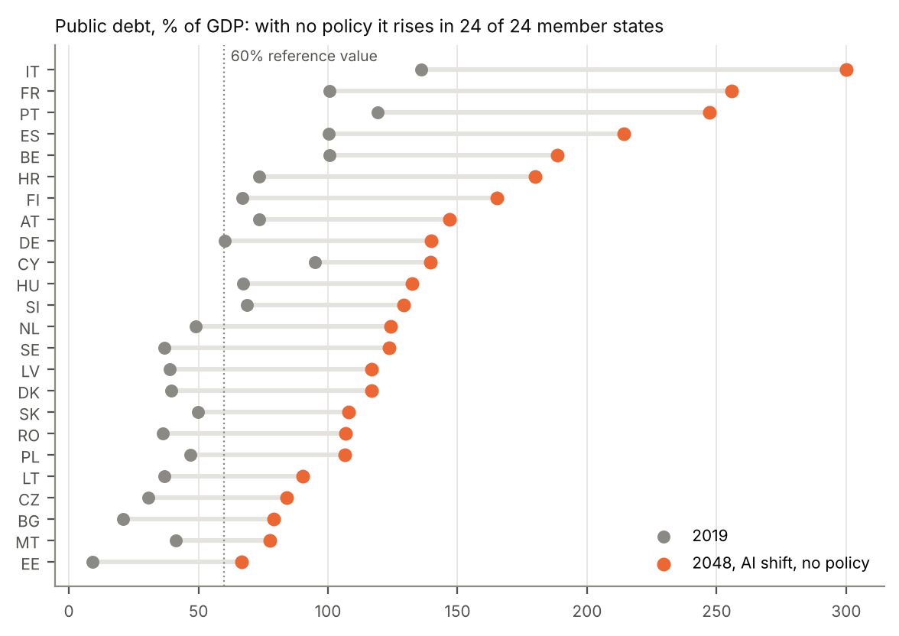
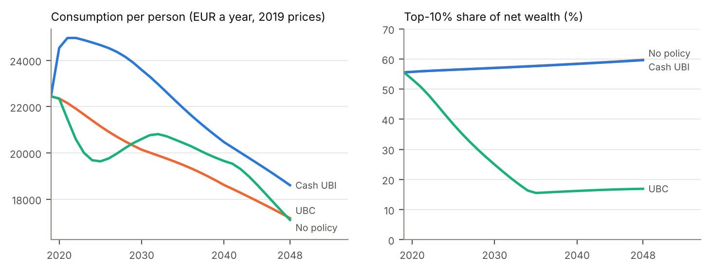

# AGORA — a sandbox for the economics of abundance

[](https://doi.org/10.5281/zenodo.20726928)
[](https://creativecommons.org/licenses/by/4.0/)


**AGORA** is an open, **stock-flow-consistent** model of 24 EU economies. It asks what
happens to households and public finances if AI moves income from work to capital, and
what cash transfers and citizen ownership (**Universal Basic Capital**) can and cannot do
about it. Every policy runs inside one accounting-complete world, calibrated to each
country's 2019 data.

> **Sandbox, not oracle.** AGORA produces *scenario comparisons under explicit,
> swappable assumptions*, not forecasts. Every parameter is sourced or labelled as an
> assumption with a Monte-Carlo range; every scenario must pass a consistency gate (no
> money created or lost in the accounts) before any result is reported.

> **Correction, v1.2 (November 2026).** An October 2026 review found that the earlier
> headline results came from runs that balanced their books but were not economically
> plausible. The engine was rebuilt (capacity limits and prices, credit constraints,
> foreign ownership of capital and of the AI rent, market-priced shares, banks, existing
> loans, each country's own capital stock and trend growth, gradual consumption:
> [`docs/PHASE7.md`](docs/PHASE7.md)) and every published claim was re-run. These did
> not survive: the citizens' dividend overtaking cash, "UBC dominates cash and inaction",
> "with reinvestment the UBC economy ends larger", "pooling halves the European gap" and
> "validated against history". Each finding and its status:
> [`docs/FINDINGS-LEDGER.md`](docs/FINDINGS-LEDGER.md).

📄 **Read the study:** *Who Owns the Machine? AI, the labour share and Europe's policy choices* (v1.2, 10 pp) → [`AGORA_Manifesto.pdf`](AGORA_Manifesto.pdf) · all versions: https://doi.org/10.5281/zenodo.20726928
🔗 **Live dashboard:** https://brano80.github.io/agora/

---

## What the model shows

One stated scenario: AI pushes the labour share from 66% to 30% of income by 2048, with an
investment boom in AI capital. Germany is the worked example; every number below is
regenerated by [`scripts/build_manifesto.py`](scripts/build_manifesto.py).

### 1. The welfare state's tax base erodes
European welfare states are funded mostly by taxes on wages. With no policy response,
German wage-tax revenue falls from 13.8% to 7.1% of GDP by 2048; taxes on profits rise
from 5.9% to 8.9%, not enough to make up the gap. Public debt rises in all 24 member
states, from a median of 55% to 127% of GDP, and 7 end above 150%. This holds whatever
one thinks of basic income.



### 2. Cash and ownership trade consumption now for wealth later
A 40% levy on profits is either paid out as a cash basic income or taken as shares in a
citizens' fund that pays out 3% of its value a year (Norway's rule).
- **Cash UBI** raises average consumption per person by 13% over no policy, but leaves
  the top-10% share of wealth where it was heading (60%).
- **Universal Basic Capital** raises consumption by 1%, cuts the top-10% wealth share
  from 56% to 17% and ends with the lower income Gini (0.20 against 0.24).
- **The dividend stays below the cash transfer** every year to 2048 (€5,324 against
  €7,739 per person).
- **Both cost output.** GDP ends about 8% below the no-policy path, because both tax the
  profits that fund investment.

Neither form dominates. Across 500 joint draws of 19 uncertain assumptions (Germany,
France, Slovakia), UBC is more equal in every draw and cash gives more consumption in
every draw ([`docs/ROBUSTNESS-2026-11.md`](docs/ROBUSTNESS-2026-11.md)). The size of the
inequality gap depends mostly on one parameter that recent data cannot identify; the
direction does not.



### 3. Europe does not own most of the machine
By 2048 the AI rent reaches 36% of German GDP, and 70% of it is paid abroad as licence
and cloud fees (the US providers' share of Europe's cloud market). Real GDP rises 10%
while real national income falls 13%, and consumption per person ends 23% below 2019.
Domestic taxes and claims reach only the domestic part: a 40% claim in shares reaches 25%
of the AI rent, and a 3% levy on fees paid abroad reaches 0.3% of the foreign part,
because providers pass it on. Six real 2026 proposals (a stock levy, AI pledges, a
borrowing-financed fund, child accounts, a source levy, a broad-base UBI) each move
national income by a few per cent at most.

A dividend pooled across the Union narrows the gap between member states by 32% (cash) or
21% (UBC) by 2048, with transfers of up to €15,822 per person a year from the richest
members.

### What the model cannot tell you
- **It is not a forecaster.** Started in 2010 and fed the policy and world demand that
  actually happened, it tracks 2011–2019 no better than a random walk or a static
  multiplier: it beats both in 37% of country-variable cases
  ([`docs/VALIDATION-2026-11.md`](docs/VALIDATION-2026-11.md)). Its first-year fiscal
  multipliers sit inside the published ranges; year-two responses are above them.
- **The AI shock is assumed,** and its size drives most results.
- **No exchange rates or monetary reaction;** inflation is anchored near 2%.
- **EL, IE and LU are excluded** ([`schema/coverage.py`](schema/coverage.py)).

## How it's built
- **Stock-flow-consistent core** with capacity limits, prices, a banking sector and a
  government with a fiscal rule, plus pluggable modules (distribution · input-output ·
  AI shock · citizens' fund · multi-region) through a common schema.
- **Data:** Eurostat national and financial accounts, AMECO (wage shares, capital
  stocks, interest rates), ECB bank rates, OECD income and wealth distribution, Eurostat
  **FIGARO** input-output, the 2024 Ageing Report, integrated via DBnomics. 24 EU members
  usable.
- **Checked:** a consistency gate on every run (residuals ~1e-10 of GDP); plausibility
  laws (88% of 3,455 audited runs pass: [`docs/AUDIT-2026-11-stepF.md`](docs/AUDIT-2026-11-stepF.md));
  a 2011–2019 backtest against naive benchmarks; **422 automated tests**.
- Pure standard-library Python engine.

## Drive it in plain language (MCP + agent crew)

AGORA runs as an **MCP server**, so any AI assistant — Claude Desktop, Claude Code,
VS Code — can drive the model directly, and a small **agent crew** turns a
plain-language request into a gated, reported run. Ask in words:

> *"Compare cash UBI vs UBC under an AI shock in Slovakia"*
> *"What's the policy trade-off frontier for Germany?"*
> *"Run an AI shock with UBC at 40% in France"*

The crew plans the request, resolves the assumptions for your approval, runs it
through the consistency gate, and reports the result — a single scenario, a
comparison, or the Pareto frontier — always with the numbers and **never a
"winner"** (the values judgement stays with you). It runs offline with no LLM:

```bash
python agent_crew.py "What's the policy frontier for Germany under an AI shock?"
```
```
AGORA crew -- policy frontier on DE (30y). 16 non-dominated policies out of 19;
no single 'best' -- each trades one objective for another.
  - No policy: GDP 3,882,863, Gini 0.333, poverty 0.200, debt/GDP 140.
  - Cash UBI τ=40%: GDP 3,562,377, Gini 0.242, poverty 0.077, debt/GDP 137.
  - UBC τ=30%: GDP 3,644,770, Gini 0.201, poverty 0.044, debt/GDP 130.
  - Voluntary AI pledges, best case (Anthropic-style): GDP 4,002,916, Gini 0.317, ...
  ...
  Sandbox, not a forecast; every candidate passed the consistency gate. The choice is yours.
```

**Why it's trustworthy as a tool** — the guardrails live in the tool layer, not
the wrapper: every result passes the stock-flow consistency gate before it
leaves (a failing scenario returns the failing checks and *no numbers*, with no
switch to disable it); every payload carries its assumptions and data provenance;
the comparison tools have no "winner" field; and AGORA bundles **no model of its
own** — optional narration borrows the client's model via MCP sampling.

10 read-only MCP tools (`agora_run_scenario`, `agora_compare`,
`agora_policy_frontier`, `agora_preview_scenario`, `agora_narrate`, `agora_crew`,
…). Connect it:
```bash
pip install "mcp[cli]"
# then add mcp_server.py to claude_desktop_config.json (see docs/MCP.md)
```
Full tool list + setup: [`docs/MCP.md`](docs/MCP.md) · crew design: [`docs/PHASE5.md`](docs/PHASE5.md).

## Quickstart
```bash
python -m pytest tests/ -q                # run the test suite (422)
python -m streamlit run dashboard/app.py  # explore scenarios
python scripts/run_triad.py --geo DE      # baseline / AI shift / settlement
python scripts/build_manifesto.py         # rebuild the study and the charts above
```

## Repository map
- `schema/` canonical SNA accounts · `modules/` model adapters · `consistency/` the gate
- `data/` live connectors + cached snapshots · `orchestrator.py` · `scenarios.py`
- `validation.py` the 2011–2019 backtest · `uncertainty.py` the Monte Carlo
- `docs/` method, findings ledger, validation, audits · `tests/`

## Citation
```bibtex
@misc{agora2026,
  title  = {Who Owns the Machine? AI, the Labour Share and Europe's Policy Choices},
  author = {Branislav Ambroz},
  year   = {2026},
  note   = {AGORA, an open, consistency-gated model of AI's distributional and fiscal
            impact. Version 1.2 (corrects v1.0 and v1.1, "Owning the Machine")},
  doi    = {10.5281/zenodo.20726928},
  url    = {https://doi.org/10.5281/zenodo.20726928}
}
```

## License
Code & documents: **CC BY 4.0** (attribution). See `LICENSE`.

---
*AGORA is a research preview. It is a tool for comparing policies transparently — not investment, legal, or policy advice.*
